# Test Suite for SoftwareDesign
Arbeidskrav 2, semester 1, year 2, Gokstad Akademiet.

TODO: DELETE WHEN DONE!  
Testing Documentation

Must contain:
- ~~At least 5 automated tests in its own test project (add test data and screenshots here)~~
- ~~At least 3 tests should cover logic outside the components, example: GameNightState, filtering, or validation~~
- ~~At least 1 test should test a component, example: DiceRating (Rating) sending the correct value through ValueChanged. Can use bUnit~~
- ~~Tests should cover normal use and edge cases~~
- Write a manual test log for test cases in ~~task 1, 2~~, 3, 4 that aren't automated. Log should show test case, steps, expected result
  and actual result.

---

## Overview
- [Task 1 Tests](#task-1-tests)
- [Task 1 Manual Test Log](#task-1-manual-test-log)
- [Task 1 Automated Tests](#task-1-automated-tests)
- [Task 2 Tests](#task-2-tests)
- [Task 2 Manual Test Log](#task-2-manual-test-log)
- [Task 2 Automated Tests](#task-2-automated-tests)
- [Task 3 Tests](#task-3-tests)
- [Task 3 Manual Test Log](#task-3-manual-test-log)
- [Task 3 Automated Tests](#task-3-automated-tests)
- [Task 4 Manual Test Log](#task-4-manual-test-log)
- [Task 4 Automated Tests](#task-4-automated-tests)

---

## Task 1 Tests

<strong>Expand to see manual test log for task 1</strong>

 

## Task 1 Manual Test Log

**Case: _Search with no hits, clicking "Choose a random game!" does not crash_**    

**Steps:**  
- Search for `asd`
- Number of players: `Any`
- Click `🎲Roll the die`

**Expected result:**    
- `Hits: 0`
- `No games matching the search.`
- No hits
- No crash

**Actual result:**  
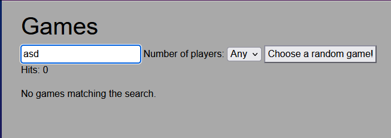

**Case: _Search with hits, random game highlight working_**    

**Steps:**  
- Search for something that yields at least 2 results
- Click `🎲Roll the die`

**Expected result:**
- `Hits: 2`
- No message for no matching games
- Highlighted random game

**Actual result:**  
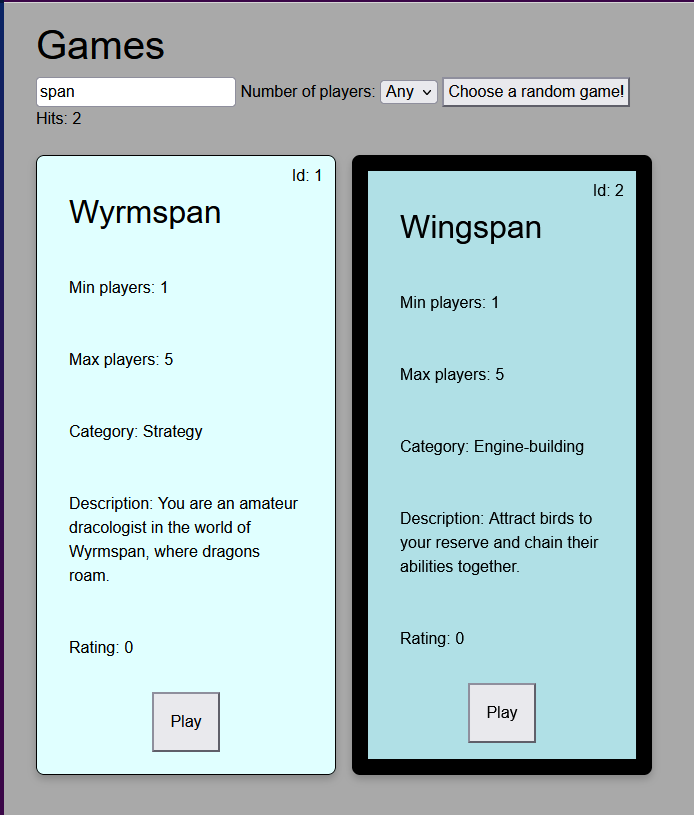

**Case: _Dropdown menu affects hits_**    

**Steps:**  
- Pick 7 players
- Pick 9 players

**Expected result:**  
- `Hits: 3`
- `Hits: 1`

**Actual result:**    
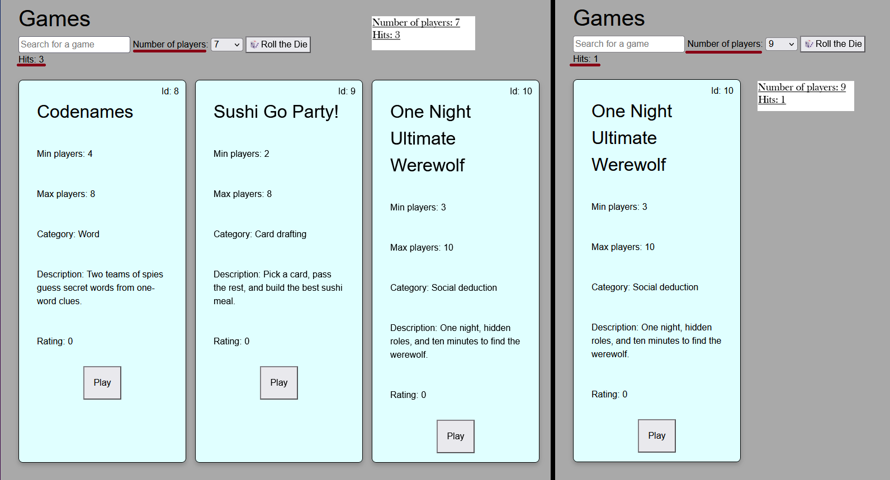

**Case: _Filtering and dropdown work together_**  

**Steps:**  
- Search for `span`
- Dropdown: `5 players`
- Dropdown: `6 players`

**Expected result:**  
- `Hits: 2`
- Two games, `Hits: 2`
- No hits, `No games matching the search`

**Actual result:**  
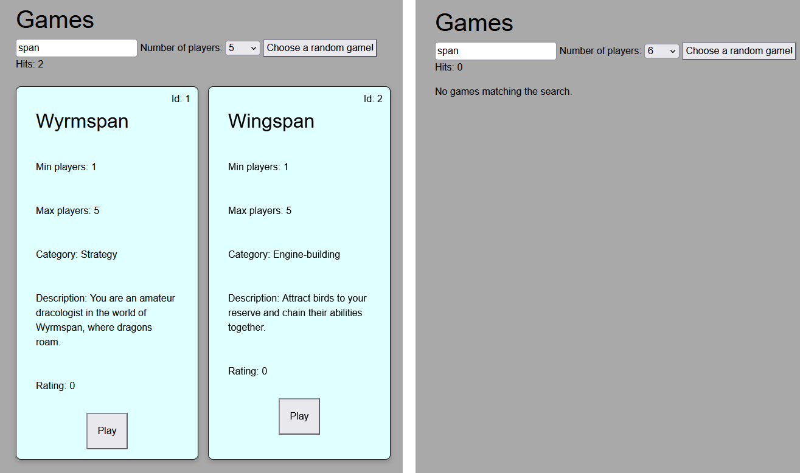

---

<strong>Expand to see automated tests for task 1</strong>

 

## Task 1 Automated Tests
Task 1 test coverage.
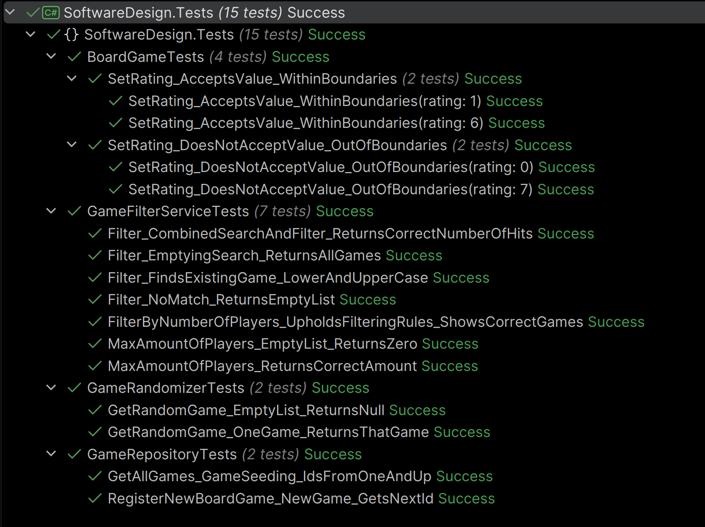

**Test names:**  

- `BoardGame.SetRating`
- `GameFilterService.Filter` 
- `GameFilterService.FilterByNumberOfPlayers` 
- `GameFilterService.MaxAmountOfPlayers`
- `GameRandomizer.GetRandomGame`
- `GameRepository.GetAllGames`
- `GameRepository.RegisterNewBoardGame`

**Test cases:**

- Edge cases
- No hits
- Empty collections
- Guards for rating
- Range for number of players
- Upper and lowercase searches

---

## Task 2 Tests

<strong>Expand to see manual test log for task 2</strong>

 

## Task 2 Manual Test Log

**Case: Looking up an ID that exists**  

**Steps**  
- Navigate to `/games/1` using the URL field

**Expected result**  
- Game: Wyrmspan

**Actual result**  
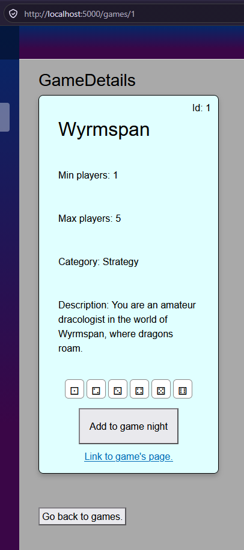

**Case: Looking up an ID that does not exist**  

**Steps**  
- Navigate to `/games/999` in the URL field

**Expected result**  
- Message displaying: `No game with ID 999 found.`
- Link back to game library: `Go back to the game library`

**Actual result**  
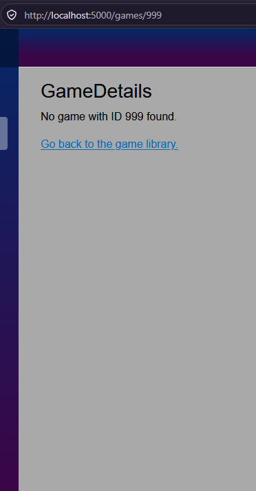

**Case: Looking up an ID that is a string and not an int**  

**Steps**  
- Navigate to `/games/abc` in the URL field

**Expected result**  
- `Not Found` page
- Text saying: `Sorry, the content you are looking for does not exist`
- Link to go back home: `Go back to Home`

**Actual result**  
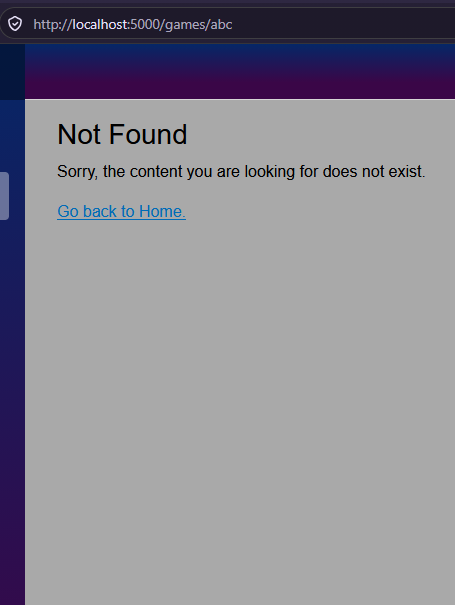

This fails because the type is `int`, set in the page `GameDetails` in the route pattern 
`/games/{Id:int}`. `abc` is not an int, so it won't match. `GameDetails` never runs, so we don't get the 
`No game with ID` message, and the router shows the "Not Found" page instead.

**Case: Clicking the clickable die changes the rating immediately**  

**Steps**  
- Click the link `Link to game's page` on the first game
- Click on the die for `3` in the clickable row

**Expected result**  
- Clickable (outside the card) and un-clickable die are marked immediately on both

**Actual result**  
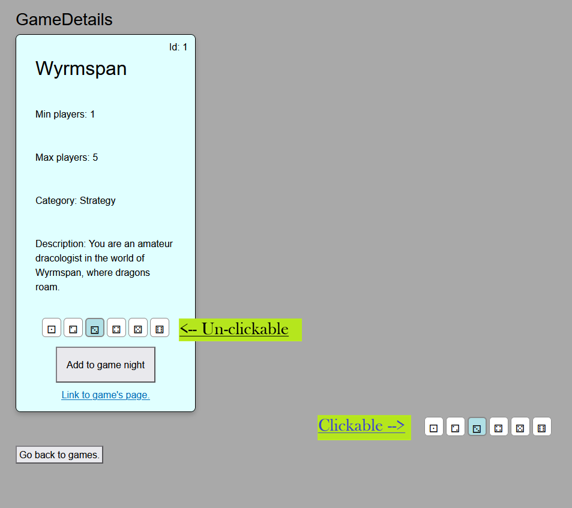

Automated test also covers this case, further down in [this document](#task-2-automated-tests), 
in the test: `DiceRating_NotReadOnly_ClickingADieFace_ReportsTheCorrectRating`.

**Case: Active menu is marked**

**Steps**
- Run the project
- Go to "`/games`" (either type manually or use the sidebar)
- Go to "`/`"

**Expected result**  
- `Games` section will be marked
- `Home` section will be marked

**Actual result**  
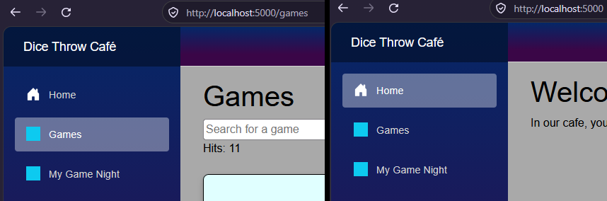

---

<strong>Expand to see automated tests for task 2</strong>

 

## Task 2 Automated Tests

Automated tests for task 2 running and succeeding:
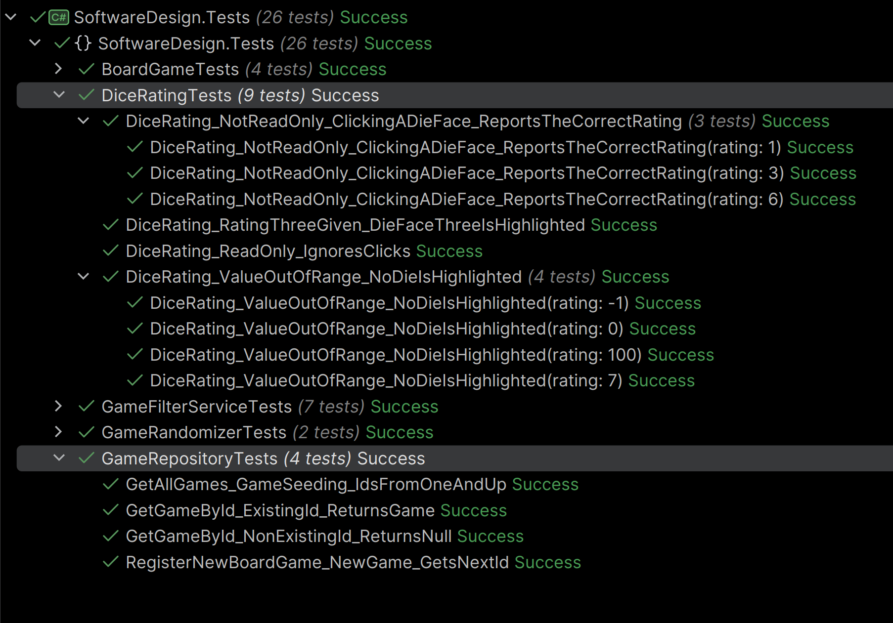

**Test names:**  
`DiceRating` tests:  
- `DiceRating_NotReadOnly_ClickingADieFace_ReportsTheCorrectRating` (1 theory with 3 data rows)
  (_This test was also manually checked by hardcoding `1` and removing the ReadOnly guard in the method to ensure 
`1` would still pass, while `3` and `6` would fail._)
- `DiceRating_RatingThreeGiven_DieFaceThreeIsHighlighted`
- `DiceRating_ReadOnly_IgnoresClicks`
- `DiceRating_ValueOutOfRange_NoDieIsHighlighted` (1 theory with 4 data rows)

`GameRepository` tests (new in task 2):  
- `GetGameById_ExistingId_ReturnsGame`
- `GetGameById_NonExistingId_ReturnsNull`

**Testing:**
- Edge cases
- Parent gets correct value for dice rating
- Out of range values
- Read-only ignores clicks
- Out-of-range values highlight nothing
- `GetGameById` returns a game for an existing ID, and `null` if the ID does not exist.

---

## Task 3 Tests

<strong>Expand to see manual test log for task 3</strong>

 

## Task 3 Manual Test Log
**Case: Adding game from shelf is visible in `MyGameNight`**

**Steps:**  
- Click "Add to game night" on any game
- Watch "My Game Night" in the navigation menu
- Navigate to "My Game Night"

**Expected result:**  
- Button on game card changes from `add` to `remove`
- A die with the number of games added shows next to "My Game Night" in navigation menu
- The game will display when navigating to "My Game Night"

**Actual result:**  
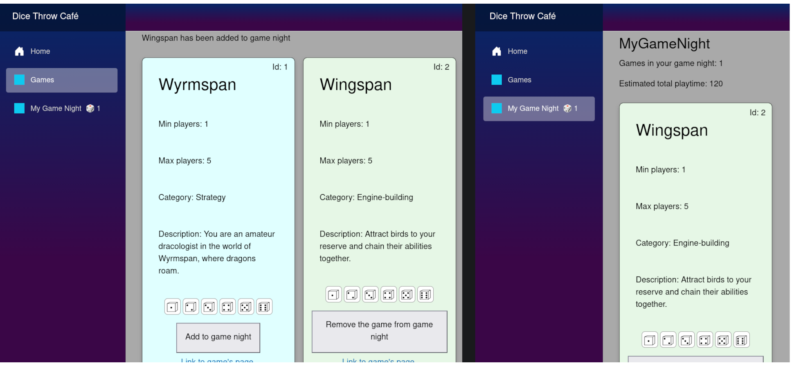

**Case: State survives navigation**  

**Steps:**
- With a game in "My Game Night", navigate to `Home`, `Games`, and to a game's page

**Expected result:**
- The die with the number will remain to the right of "My Game Night" in the navigation menu
- The state will survive navigation

**Actual result:**  
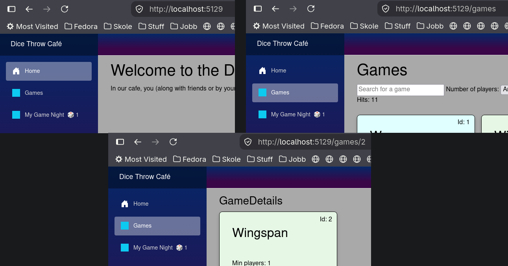

**Case: The same game cannot be added twice**

**Steps:**
- Add a game using the "Add to game night" button

**Expected result:**
- The button will change from `Add` to `Remove`, making duplicate addition impossible
  (the service also ignores a second add)

**Actual result:**  
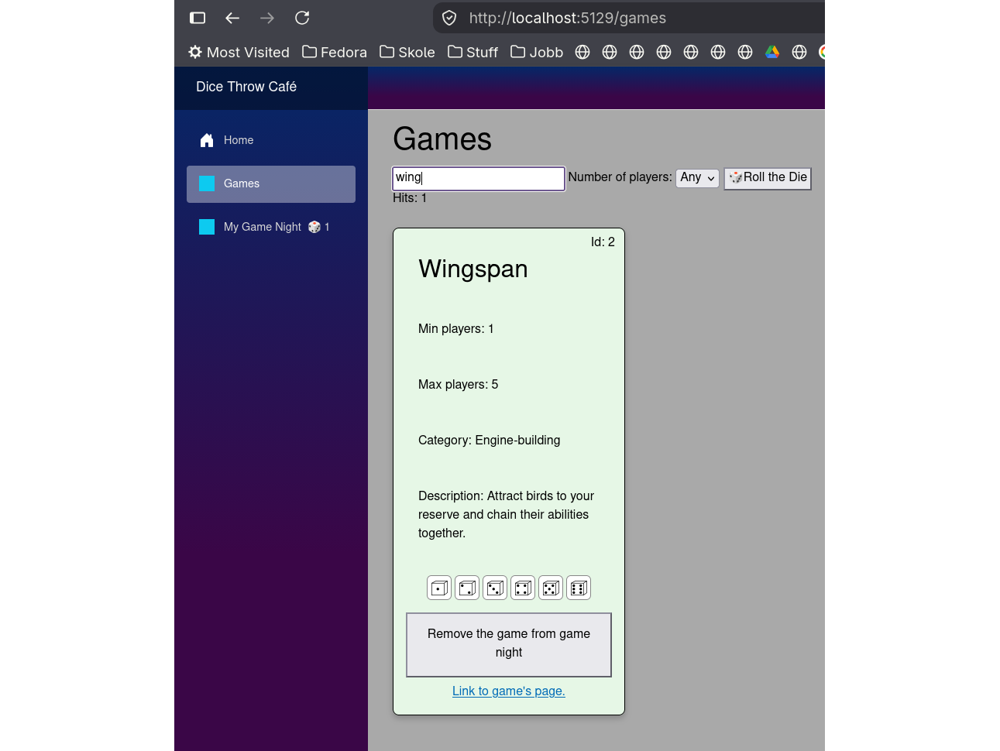

**Case: Remove the last game from the list**

**Steps:**  
- Navigate to "My Game Night"
- Click "Remove the game from game night"

**Expected result:** 
- The game will disappear
- The page will show a count of 0
- The page will show a message saying you haven't added any games
- The page will show a link to go to the game library, and one to go to home

**Actual result:**  
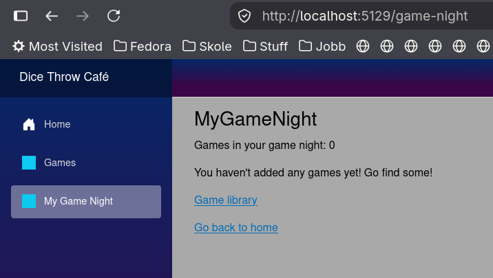

**Case: Total amount of playtime summarized with three games**

**Steps:**
- Add three games to "My Game Night": `Wyrmspan`, `Wingspan`, `Gloomhaven`
- Navigate to "My Game Night"

**Expected result:**
- The page will report 3 games in the list
- The page will report a combined estimated playtime of `300 minutes`

**Actual result:**  
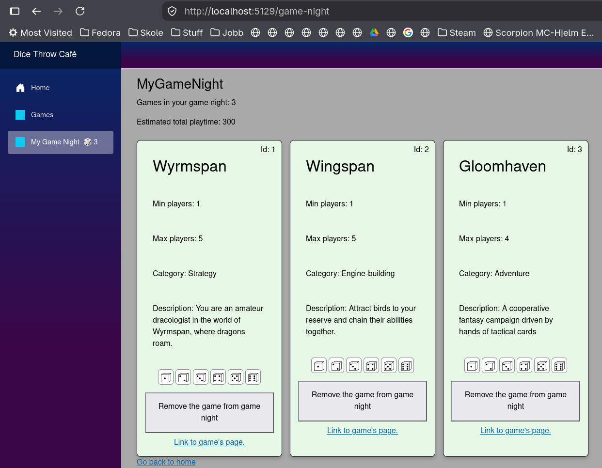

**Case: Scoped Service, one circuit per tab**

**Steps:**
- Add games to "My Game Night" in one tab
- Open a new tab
- Navigate to "My Game Night" in the new tab and find it empty

**Expected result:**
- First tab will contain games you've added in "My Game Night"
- Second tab will have an empty list in "My Game Night"

**Actual result:**  
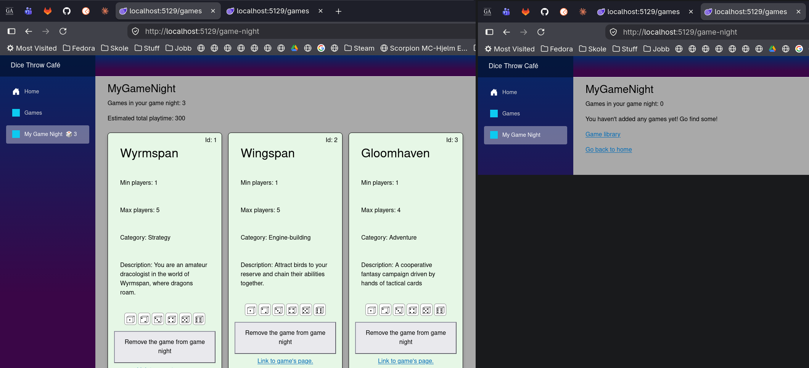

**Case: App at 375px and 1200px**  

**Steps:**
- Launch the project
- Ctrl + Shift + M
- Set width to `375` and `1200`

**Expected result:**  
- Scrollable version of the page
- Usable navigation menu in burger shape

**Actual result:**  
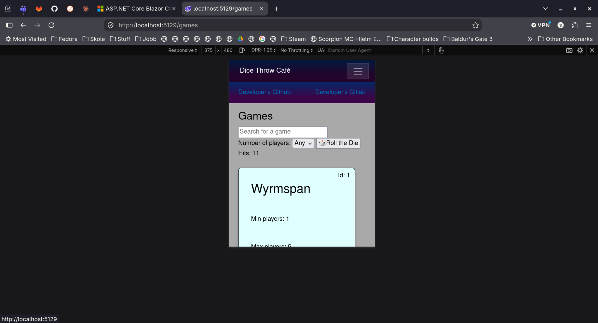 

<strong>Expand to see automated tests for task 3</strong>

 

## Task 3 Automated Tests

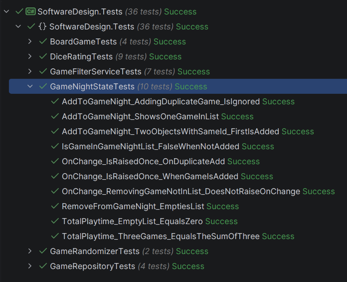

**Test names**  
- `AddToGameNight_AddingDuplicateGame_IsIgnored`
- `AddToGameNight_ShowsOneGameInList`
- `AddToGameNight_TwoObjectsWithSameId_FirstIsAdded`
- `IsGameInGameNightList_FalseWhenNotAdded`
- `OnChange_IsRaisedOnce_OnDuplicateAdd`
- `OnChange_IsRaisedOnce_WhenGameIsAdded`
- `OnChange_RemovingGameNotInList_DoesNotRaiseOnChange`
- `RemoveFromGameNight_EmptiesList`
- `TotalPlaytime_EmptyList_EqualsZero`
- `TotalPlaytime_ThreeGames_EqualsTheSumOfThree`

**Test cases**  
- Edge cases
- Duplicate adds ignored
- Adding one game shows one game in game list
- Two objects with same ID added, only the first one is added
- Return false if game is not added to game night
- OnChange is raised only once on a duplicate add
- OnChange is raised once when a game is added
- Removing a game does not raise OnChange
- Removing a game from a single element list empties the list
- Total playtime on an empty list equals zero
- TotalPlaytime sums up the playtime for three games

---

## Task 4 Tests

<strong>Expand to see manual test log for task 4</strong>

 

## Task 4 Manual Test Log
- Case
- Steps
- Expected
- Actual

<strong>Expand to see automated tests for task 4</strong>

 

## Task 4 Automated Tests

---