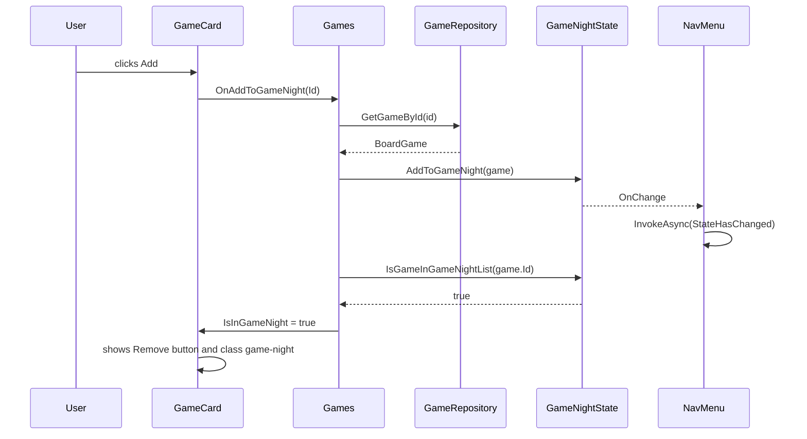
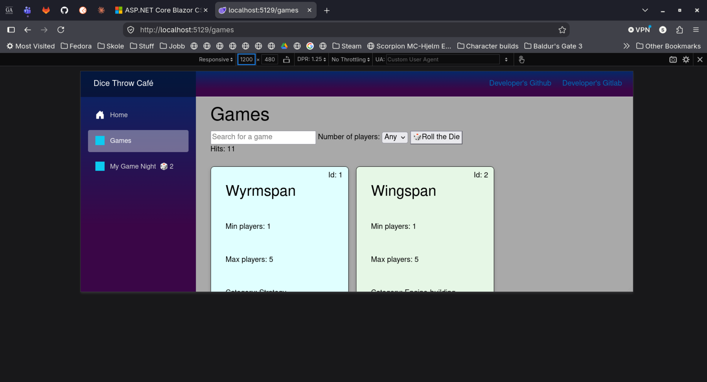

# Dice Throw Café
_(Translated from Norwegian to English)_

---

## Overview
- [Tasks](#tasks)
    - [Task 1 - Game Shelf](#game-shelf)
    - [Task 2 - Dice Throw and Game Page](#dice-throw-and-game-page)
    - [Task 3 - My Game Night](#my-game-night)
    - [Task 4 - Behind the Counter](#behind-the-counter)
    - [Task 5 - Design Documentation, Choices, and Testing](#design-documentation-design-choices-and-testing)
    - [Task 6 - Video Presentation](#video)
- [Sources](#sources)

---

## Tasks
### Game Shelf
**Task 1:  
Components and data binding.**

**Pages and Components:**  

| Part                                  | Does                                                                                                                                                                                                                            | Does not                                                             |
|---------------------------------------|---------------------------------------------------------------------------------------------------------------------------------------------------------------------------------------------------------------------------------|----------------------------------------------------------------------|
| `Home.razor`                          | Dice Throw Café home page. Welcomes the user.                                                                                                                                                                                   |                                                                      |
| `GameRepository.cs`                   | Owns the list, hands it out as read-only, owns IDs.                                                                                                                                                                             | Knows nothing about pages or search.                                 |
| `GameRepository.RegisterNewBoardGame` | Registers a new game and assigns an ID to the game during creation.                                                                                                                                                             |                                                                      |
| `Games.razor`                         | Displays the library of games, allows search and filtering. Asks the repository for the games in `OnInitialized`, holds the search text, filters in one property, loops, and shows empty states (no result / empty games list). | Does not own or create games.                                        |
| `GameCard.razor`                      | Shows one game per card.                                                                                                                                                                                                        | Does not know the list, the search, or the repository.               |
| `GameFilterService.cs`                | Handles real-time filtering on letters and number of players.                                                                                                                                                                   | Does not know where the data comes from.                             |
| `GameRandomizer.cs`                   | Handles the choice of a random game based on the current view the user sees.                                                                                                                                                    | Does not know about anything but the games list.                     |
| `BoardGame.cs`                        | The model for a board game. Validates its own rating (1 - 6).                                                                                                                                                                   | Does not know anything about the other classes, pages or components. |

**Why Page and Component are split**  
`GameCard` (component) and `Games` (page) are split because it is a more practical way to display and maintain 
the game information. The `GameCard` is a reusable component that can easily be used on any page.  

**Responsibilities**  
The page, `Games.razor`, is responsible for displaying the `GameCard` and looping over the contents of the list received through 
`GameRepository`. It displays buttons, search field, dropdown menu for number of players, and the `GameCard`.  
It handles the button `@onclick` and displays the number of search hits. It also has logic for empty lists and non-results.

The component, `GameCard.razor`, is responsible for the information in each card, and uses Parameter properties 
which are passed down from the parent (`Games`) to the card, and correspond with the `BoardGame` model which every board game uses.  
`GameCard` also handles the highlighting of a picked card, and is told by the page whether it is the picked card. 
The page compares each game with the picked one and passes `IsPickedCard`. The card decides how the picked card looks.
It knows nothing about the list, the search, or the repository.

**Later Changes**  
If I want to change how a card looks, I only have to change `GameCard`, because the page only displays the `GameCard`.  
If I add a new field to `BoardGame`, I have to change the `BoardGame constructor`, the `RegisterNewBoardGame` signature, 
the calls to `RegisterNewBoardGame`, and the tests that create games. I also have to change `Games.razor` and `GameCard`
because the page needs to pass the new value, and the card needs a new parameter to show it.      
This is the cost of the six separate parameters, but it keeps the card independent of `BoardGame`.

**Test Results:**  
Refer to the documentation in [Test Suite README](../SoftwareDesign.Tests/README.md)

**Design Choices:**  
Refer to the documentation in [DesignChoices.md](../Docs/DesignChoices.md)

**AI Assistance Documentation:**  
Refer to the documentation in [AIUse.md](../Docs/AIUse.md)

---

### Dice Throw and Game Page
Task 2:  
Component communication and navigation.

**Components, pages and classes**

| Part                         | Does                                                                                                                                                                                                                     | Does not                                                             |
|------------------------------|--------------------------------------------------------------------------------------------------------------------------------------------------------------------------------------------------------------------------|----------------------------------------------------------------------|
| `DiceRating.razor`           | Component, runs a foreach loop with a range from 1 - 6, Value and ReadOnly comes DOWN from parent. ValueChanged reports UP.                                                                                              | Does not know about other pages, does not change its own Value.      |
| `DiceRating.razor.css`       | Handles the styling for the component.                                                                                                                                                                                   | Does not hold logic.                                                 |
| `GameCard.razor`             | Now shows a read-only `DiceRating` and raises `OnAddToGameNight` if a user adds a game.                                                                                                                                  | As noted in Task 1 table.                                            |
| `GameRepository.GetGameById` | Looks up a game using its ID. Returns null if ID does not exist.                                                                                                                                                         | Does not decide what the page shows for missing game (page decides). |
| `GameDetails.razor`          | Displays `GameCard` for chosen game (by ID), has button for going back to games, calls on `BoardGame`'s `SetRating` method instead of using `@bind-Value`. Uses NavigationManager in the button. Has handler for Rating. | Does not write to the rating directly, goes through `SetRating`.     |
| `Games.razor`                | Now has a confirmation field holding a message that is displayed if a game is added to "My Game Night". Message is not shown if a game is not added to "My Game Night".                                                  | Does not store the added game or decide what "adding" means.         |
| `NavMenu.razor`              | Displays linked pages in the left side of the main page layout.                                                                                                                                                          |                                                                      |
| `MyGameNight.razor`          | Does nothing for task 2, will contain data in task 3. Created skeleton for `NavMenu`. Does have a link to go back to Home.                                                                                               |                                                                      |
| `NotFound.razor`             | Handles situations where a page does not exist. Has a link to go back to Home.                                                                                                                                           |                                                                      |

**Page table**  

| Route               | Goes to                                                                                                |
|---------------------|--------------------------------------------------------------------------------------------------------|
| `"/"`               | Goes to the root, "Home". The start page of the project.                                               |
| `"/games"`          | Goes to the "Game Shelf" where all games are displayed using `GameCard`.                               |
| `"/games/{Id:int}"` | Is a direct route to each game's page, navigated using the ID.                                         |
| `"/game-night"`     | Goes to the "My Game Night" page that is empty for this task.                                          |
| "`/not-found`"      | Goes to the "Not Found" page in instances where a user tries to navigate to a page that does not exist |

**DiceRating table**  

| Name           | Type                 | Direction | What it means                                                                                          |
|----------------|----------------------|-----------|--------------------------------------------------------------------------------------------------------|
| `Value`        | `int`                | Down      | Gives the child an int value and decides which die is highlighted.                                     |
| `ValueChanged` | `EventCallback<int>` | Up        | Carries an `int` and is raised when the user clicks a die face, and not at all when `ReadOnly = true`. |
| `ReadOnly`     | `bool`               | Down      | When true, switches off the clicks in the `GameCard` (example, shelf card).                            |

A value within the range of 1 - 6, highlights a die face. Any other value (including 0 for an unrated game), leaves all six 
unhighlighted.  
The `@bind-Value` is supported by the component, but due to encapsulation, the `Rating` can only be set through `SetRating`.   
The page instead uses `Value` and `ValueChanged`, and the handler calls `SetRating`. 

**GameCard table**

| Name               | Type                     | Direction | What it means                                                                                                     |
|--------------------|--------------------------|-----------|-------------------------------------------------------------------------------------------------------------------|
| `Id`               | `int`                    | Down      | Game's unique ID. Shown in the top right corner, used in the link to the game's page.                             |
| `Name`             | `string`                 | Down      | The game's name. Also what `OnAddToGameNight` carries.                                                            |
| `MinPlayers`       | `int`                    | Down      | Minimum number of players.                                                                                        |
| `MaxPlayers`       | `int`                    | Down      | Maximum number of players.                                                                                        |
| `Category`         | `string`                 | Down      | The category of the game.                                                                                         |
| `Description`      | `string`                 | Down      | A short game description.                                                                                         |
| `Rating`           | `int`                    | Down      | The game's rating, shown in a read-only `DiceRating`.                                                             |
| `IsPickedCard`     | `bool`                   | Down      | When "true", adds the class `picked-card` to highlight a randomly picked game.                                    |
| `OnAddToGameNight` | `EventCallback<string>`  | Up        | Raised when the user clicks "Add to game night". Carries the game's `Name` (string). Parent decides what happens. |

**Data UP and data DOWN examples**  
`DiceRating`: the parent (`GameDetails`) owns the rating, which lives in `BoardGame`.   
`Value` goes down so the component can display it.  
When a die is clicked, `ValueChanged` goes up with the new value.  
The parent then updates the value, and a new Value comes down.  
The component never changes the value directly.

`GameCard`: the parent (`Games`) owns the list of games that are loaded from the repository, and a confirmation message.
The game's data goes down into `GameCard`, through its parameters (`Id`, `Name`, etc.).  
When the user clicks "Add to game night", `OnAddToGameNight` goes up with the game's `Name` (string).  
The parent then shows a confirmation message, and the card never decides what "adding" means.

**Why `/games/abc` fails**  
Documented in the [Test Suite README](../SoftwareDesign.Tests/README.md) under `Task 2 Manual Test Log`.

**Limitations**  
- Page `GameDetails` will have dead buttons for now when I reuse the card. This will solve itself in task 3 with shared state.
- Two rating rows: for now there are two rating rows where one is static and follows the card, and one is clickable on the 
`GameDetails` page.
- In task 2, the set rating will not yet be stored, only displayed.

**Test Results:**  
Refer to the documentation in [Test Suite README](../SoftwareDesign.Tests/README.md)

**Design Choices:**  
Refer to the documentation in [DesignChoices.md](../Docs/DesignChoices.md)

**AI Assistance Documentation:**  
Refer to the documentation in [AIUse.md](../Docs/AIUse.md)

---

### My Game Night
Task 3:  
Application state and responsive UI.

**Components, pages, classes**  

| Part                    | Does                                                                                                                                                                                                                   | Does not                                                                         |
|-------------------------|------------------------------------------------------------------------------------------------------------------------------------------------------------------------------------------------------------------------|----------------------------------------------------------------------------------|
| `GameNightState`        | Holds the state for a user's Game Night, list of full games, rule for no duplicate additions. Handles Add, Remove, and a check to see if game is in the list already.                                                  | Know anything about the pages or components, or find and create games (repo).    |
| `NavMenu`               | Added `@code` section. Subscribes to events from `GameNightState` in `OnInitialized`. Added method `Dispose`. Implements `IDisposable`. Reads from `NumberOfGames`. Listens for `OnChange`.                            | Own or change the list.                                                          |
| `GameCard` (Parameter)  | Page passes `IsInGameNight` down, and the card uses it.                                                                                                                                                                | Look up the service or decide if a game is in the list (page passes the answer). |
| `GameCard` (CallBack)   | Change to `EventCallback`, now carries `Id` instead of `Name`. Added param `OnRemoveFromGameNight`, reports the click with the `Id`.                                                                                   | Carry `Name`(string), change the list itself.                                    |
| `BoardGame`             | Now makes use of `PlaytimeMinutes` in the constructor.                                                                                                                                                                 | As in previous table.                                                            |
| `MyGameNight`           | Displays list and total playtime. Shows number of games, and empty message with links. Handles removing a game from game list.                                                                                         | Own the list or work out the total playtime.                                     |
| `Games`                 | New handlers for adding and removing game from game night, markup logic works out the value per card and passes it down. Asks the service for the list, and keeps only its own local state (search text, picked game). | Keep the game night list.                                                        |
| `GameDetails`           | New handlers for adding and removing game from game night. Calls the service through the handlers.                                                                                                                     | Keep the list.                                                                   |
| `Program.cs`            | New scoped service: `GameNightState`.                                                                                                                                                                                  | Share one list between users.                                                    |

**Data flow**  

**Flow notes:**  
The user `click`s the button, and then the event goes **up** from `GameCard` to `Games` page as an `EventCallback`, 
carrying the `game.Id`.  
`Games` (page) finds the game and calls `GameNightState.AddToGameNight`, which is where the user list lives.  
(_All_ games live in `GameRepository`, which is the truth source).  
The answer goes **down** to each card as the parameter `IsInGameNight` with "yes" or "no".  
`NavMenu` is neither parent nor child of the page, but is _subscribed_ to `OnChange`, so it hears when the service 
rings a bell (the `OnChange` event) and `NavMenu` redraws itself with `StateHasChanged`.

**Updated Page Table**

| Route           | Page             | Component     | Purpose                                                                  |
|-----------------|------------------|---------------|--------------------------------------------------------------------------|
| `"/game-night"` | `My Game Night`  | `MyGameNight` | Allows the user to see their chosen games, or remove them from the list. |

**State sharing assessment**  
**Problem:**  
Shelf (`Games`), game page (`GameDetails`), and game night (`MyGameNight`) must all show the same list.  
`NavMenu` must show the number of games in the list (if any).  
The list must survive navigation.

**Options considered:** 

| Option                           | Suitability | Reason                                                                                                                                                                           |
|----------------------------------|-------------|----------------------------------------------------------------------------------------------------------------------------------------------------------------------------------|
| `Parameters` and `EventCallback` | Negative.   | Would go through the component. Not usable because parent-child is required, and not present here.                                                                               |
| Separate `state service`         | Positive.   | Uses events and subscriptions. Easy to implement. Can be reached from all components.                                                                                            |
| `Cascading Values`               | Negative    | It only passes data down and has no built-in way to tell components that something changed so  I would still need a bell. I am also not familiar enough with it to use it - yet. |

**Choice:**  
`State service`. It owns the list, the rules and the guards. The service is Scoped for navigation survival, and limited to 
one circuit (two tabs show different results, as proven by the manual tasks in [Test Suite README](../SoftwareDesign.Tests/README.md)).  
It is reachable by any component. The event tells subscribed components when it changes.

**Cost:**  
- Components depend on a service and must unsubscribe (Dispose)
- The list is lost on "Refresh"

**Local VS Application state**  

| State of        | Lives in         | Who needs to know?                                  | Must state survive navigation? |
|-----------------|------------------|-----------------------------------------------------|--------------------------------|
| Search text     | `Games` page     | Only `Games` page                                   | No                             |
| Game Night list | `GameNightState` | `Games`, `GameDetails`, `NavMenu` and `MyGameNight` | Yes                            |

- The search text does not need to survive navigation. It will revert when the user navigates, which is expected
and perfectly fine for a search field. It is local state.  
- The game night list must survive navigation, and other pages need to know about the state in order to keep track 
of which games have already been added to the user's list. It is application state.

**Scoped VS Singleton**  

| Lifetime    | How long does it live                        | Who shares it                                                   | Suitable for                                         |
|-------------|----------------------------------------------|-----------------------------------------------------------------|------------------------------------------------------|
| `Scoped`    | In Blazor: the circuit, one tab's connection | Only that circuit (one tab).                                    | Database contexts, shopping carts, `GameNightState`  |
| `Singleton` | From app start to app shutdown               | Everyone. All users and all requests get the exact same object. | Global settings, app configuration, caching, logging |

Analogy:  
- `Scoped`: A hotel room key card: The card is assigned to _your_ stay only. It works for everything in your room during your visit.
When you check out, the key expires and the next guest gets a fresh one.  

In this project, it would be the user's list. Every user gets their own list. They don't share the same list, and can 
add and remove games from their own list without consequence for anyone else.

- `Singleton`: A public school building: there is only one building. Everyone uses the same building to go to school.  

In this project, if the user list was shared between _everyone_, everyone would get the same list, and add and remove things 
that others have added. It would cause headaches and chaos, because nobody would know who owned which game, and the total playtime
would be the sum of all the games for all the users combined.

**Two Tabs and Scoped**  
If the app is used with two tabs (or two users use it at the same time), those two will be independent of each other. They will be separate circuits.  
This is demonstrated in the [Test Suite README](../SoftwareDesign.Tests/README.md) in the Task 3 Manual Tests section.  
Adding games to "My Game Night" in one tab will not be reflected in the other tab.  
The second tab can have an empty list, or other (and the same) games can be added to that list without touching the first
tab.

**Render Mode**  
- Interactivity: Global
  - `Routes` and `HeadOutlet` in App.razor have @rendermode="InteractiveServer"
  - Program.cs calls AddInteractiveServerRenderMode().  
The routes passes this mode to every new page. This makes the menu and all pages run inside the same circuit.  
Because the Scoped service lives as long as its circuit, `GameNightState` and its list survives navigation.  
If interactivity was set `per page`, moving to a page without the `@rendermode` would close the circuit, and the list 
would be lost. The buttons and the menu badge would also stop reacting.  
The cost: every open tab keeps a connection and memory on the server, and the list is lost if the connection is broken
(for example on a Refresh).

**App in 375px width**  

**App in 1200px width**  

**State has one clear home**  
The state lives in the service `GameNightState`.  

`GameNightState` owns the user's list.  
It also owns the logic and guards for checking whether a game is already in the user's list (duplicate adds are ignored), 
controlled retrieval of the list, adding and removal from list.  
It keeps track of `TotalPlaytime` using a computed property that sums all the games in the list.  
It also has an `event` that is Invoked during `AddToGameNight` and `RemoveFromGameNight`.

**Test Results:**  
Refer to the documentation in [Test Suite README](../SoftwareDesign.Tests/README.md)

---

### Behind The Counter
Task 4:  
HttpClient and CRUD against Rest API.

---

## Design Documentation, Design Choices, and Testing
Task 5:  
Each subject has its own document, located in solution root directory `Docs`.  

- [Design Documentation](../Docs/DesignDocumentation.md)
- [Design Choices](../Docs/DesignChoices.md)
- [Test Documentation](../SoftwareDesign.Tests/README.md)

---

## Video
Video presentation will be available in the submission link, but not in the repo.  

[Video Presentation](../Task6_Video/presentation.mp4) (TODO: Ensure name is correct!)

---

## Sources

| Subject                                                                                     | URL                                                                                                                                                                                                                                                                                                                                                                                                |
|---------------------------------------------------------------------------------------------|----------------------------------------------------------------------------------------------------------------------------------------------------------------------------------------------------------------------------------------------------------------------------------------------------------------------------------------------------------------------------------------------------|
| **Using Max on Enumerable collection**                                                      | https://learn.microsoft.com/en-us/dotnet/api/system.linq.enumerable.max?view=net-10.0                                                                                                                                                                                                                                                                                                              |
| **DefaultIfEmpty**                                                                          | https://learn.microsoft.com/en-us/dotnet/api/system.linq.enumerable.defaultifempty?view=net-10.0                                                                                                                                                                                                                                                                                                   |
| **Refresher on Expression bodied definition**                                               | https://learn.microsoft.com/en-us/dotnet/csharp/language-reference/operators/lambda-operator#expression-body-definition                                                                                                                                                                                                                                                                            |
| **IEnumerable Any()**                                                                       | https://learn.microsoft.com/en-us/dotnet/api/system.linq.enumerable.any?view=net-10.0                                                                                                                                                                                                                                                                                                              |
| **Blazor Render Modes**                                                                     | https://learn.microsoft.com/en-us/aspnet/core/blazor/components/render-modes?view=aspnetcore-10.0                                                                                                                                                                                                                                                                                                  |
| **Blazor data binding**                                                                     | https://learn.microsoft.com/en-us/aspnet/core/blazor/components/data-binding?view=aspnetcore-10.0                                                                                                                                                                                                                                                                                                  |
| **Refresher on ternary conditional operator**                                               | https://learn.microsoft.com/en-us/dotnet/csharp/language-reference/operators/conditional-operator                                                                                                                                                                                                                                                                                                  |
| **Enumerable.Count**                                                                        | https://learn.microsoft.com/en-us/dotnet/api/system.linq.enumerable.count?view=net-10.0                                                                                                                                                                                                                                                                                                            |
| **Blazor Event Handling**                                                                   | https://learn.microsoft.com/en-us/aspnet/core/blazor/components/event-handling?view=aspnetcore-10.0                                                                                                                                                                                                                                                                                                |
| **CSS borders**                                                                             | https://developer.mozilla.org/en-US/docs/Web/CSS/Reference/Properties/border                                                                                                                                                                                                                                                                                                                       |
| **CSS Box Shadows**                                                                         | https://developer.mozilla.org/en-US/docs/Web/CSS/Reference/Properties/box-shadow                                                                                                                                                                                                                                                                                                                   |
| **CSS background color**                                                                    | https://developer.mozilla.org/en-US/docs/Web/CSS/Reference/Properties/background-color                                                                                                                                                                                                                                                                                                             |
| **Select Box Binding**                                                                      | https://stackoverflow.com/questions/58485439/select-box-binding-in-blazor                                                                                                                                                                                                                                                                                                                          |
| **CSS Text Color**                                                                          | https://www.w3schools.com/css/css_text.asp                                                                                                                                                                                                                                                                                                                                                         |
| **Die Faces UTF Symbols**                                                                   | https://www.w3schools.com/charsets/ref_utf_symbols.asp                                                                                                                                                                                                                                                                                                                                             |
| **Die Face 1**                                                                              | https://codepoints.net/search?na=DIE%20FACE-1                                                                                                                                                                                                                                                                                                                                                      |
| **Die Faces and other symbols**                                                             | https://en.wikipedia.org/wiki/Miscellaneous_Symbols                                                                                                                                                                                                                                                                                                                                                |
| **Blazor Dependency Injection**                                                             | https://learn.microsoft.com/en-us/aspnet/core/blazor/fundamentals/dependency-injection?view=aspnetcore-10.0                                                                                                                                                                                                                                                                                        |
| **Events: Subscribe / Unsubscribe**                                                         | https://learn.microsoft.com/en-us/dotnet/csharp/programming-guide/events/how-to-subscribe-to-and-unsubscribe-from-events                                                                                                                                                                                                                                                                           |
| **CSS Isolation**                                                                           | https://learn.microsoft.com/en-us/aspnet/core/blazor/components/css-isolation?view=aspnetcore-10.0                                                                                                                                                                                                                                                                                                 |
| **Cascading Values and Parameters**                                                         | https://learn.microsoft.com/en-us/aspnet/core/blazor/components/cascading-values-and-parameters?view=aspnetcore-10.0                                                                                                                                                                                                                                                                               |
| **Should my Services be Transient, Scoped, or Singleton? @Bald. Bearded. Builder. YouTube** | https://www.youtube.com/watch?v=ToFqISWq4is                                                                                                                                                                                                                                                                                                                                                        |
| **Mermaid Sequence Diagram**                                                                | https://mermaid.live/edit#pako:eNptkM9ugzAMh18l9XUBMf4EmkOnaTuse4SJS0RcQAtJ5xKtHeLdF-i6U32y5e_7WfIEjdMIEk745dE2-NqrltRQWxbq2fQNRrvdw7vrrGRvaIxjS89Z576ZImQX55_uwlesUXZBWIeK2IB_6LKLAhqtTgjurzZn-9VY6aBt7uN7dkA0rCVU4wY4tNRrkCN55DAgDWoZYVrkGsYOB6xBhpZQ-3OkFX1GjTOOaqjtHPyjsh_ODbcIcr7tQB6UOYXJH7Uab2_5R9BqpBfn7QgyS9YIkBOcQaaViLelEEWeFGmZ5TmHC0gh4iJLRFXkaV4ludjOHH7Wm0lclUUSKs3SNMseKzH_AuecfA8 |
| **GitHub Docs: Creating Diagrams**                                                          | https://docs.github.com/en/get-started/writing-on-github/working-with-advanced-formatting/creating-diagrams                                                                                                                                                                                                                                                                                        |
| **Minimal API**                                                                             | https://learn.microsoft.com/en-us/aspnet/core/fundamentals/minimal-apis?view=aspnetcore-10.0                                                                                                                                                                                                                                                                                                       |
| **Minimal API Tutorial**                                                                    | https://learn.microsoft.com/en-us/aspnet/core/tutorials/first-web-api?view=aspnetcore-10.0&tabs=visual-studio                                                                                                                                                                                                                                                                                      |
| **Native AOT**                                                                              | https://learn.microsoft.com/en-us/aspnet/core/fundamentals/native-aot?view=aspnetcore-10.0                                                                                                                                                                                                                                                                                                         |
| **Pros and Cons of Data Transfer Object (DTO)**                                             | https://learn.microsoft.com/en-us/archive/msdn-magazine/2009/brownfield/pros-and-cons-of-data-transfer-objects                                                                                                                                                                                                                                                                                     |
| **Create Data Transfer Objects (DTOs)**                                                     | https://learn.microsoft.com/en-us/aspnet/web-api/overview/data/using-web-api-with-entity-framework/part-5                                                                                                                                                                                                                                                                                          |
| **JSON Serialization Extension Methods on HttpClient**                                      | https://learn.microsoft.com/en-us/dotnet/standard/serialization/system-text-json/httpclient-extensions                                                                                                                                                                                                                                                                                             |
| **HttpJsonServiceExtensions.Configure HttpJsonOptions Method**                              | https://learn.microsoft.com/en-us/dotnet/api/microsoft.extensions.dependencyinjection.httpjsonserviceextensions.configurehttpjsonoptions?view=aspnetcore-10.0                                                                                                                                                                                                                                      |
| **How to instantiate JsonSerializerOptions instances with System.Text.Json**                | https://learn.microsoft.com/en-us/dotnet/standard/serialization/system-text-json/configure-options                                                                                                                                                                                                                                                                                                 |
